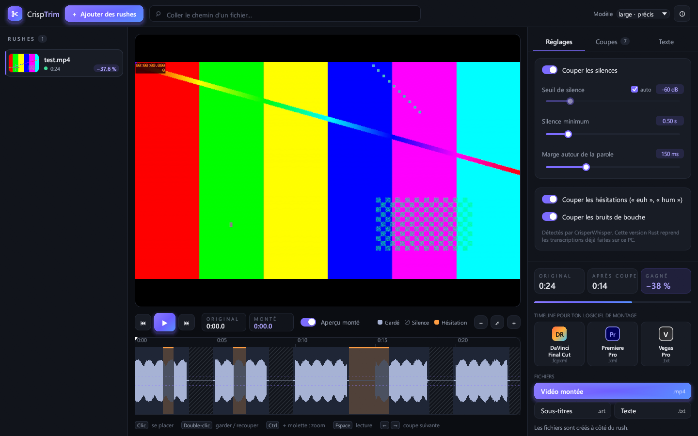

# CrispTrim

Coupe automatiquement les **silences** et les **hésitations** (« euh », « hum »…) de tes rushes,
puis exporte une timeline pour **DaVinci Resolve**, **Final Cut Pro**, **Premiere Pro**, **Vegas Pro**, ou un MP4 monté.
Tout tourne en local.

**Version 0.2 : CrispTrim est maintenant écrit en Rust** (fenêtre egui, son cpal, FFmpeg).
L'ancienne version Python reste disponible sur la branche [`python-old`](https://github.com/xLaugh/CrispTrim/tree/python-old).



## Ce que ça fait

- **Silences** : détectés sur l'énergie du son, avec un seuil automatique réglable.
- **Hésitations** : « euh », « heu », « hum », « mmh »… et bruits de bouche, repérés mot à mot par CrisperWhisper,
  transcrit directement en Rust ([candle](https://github.com/huggingface/candle)), avec l'avancement affiché.
  Le modèle se télécharge au premier fichier (turbo 1,6 Go sur processeur, large 3,1 Go sur carte graphique).
  Sur un PC NVIDIA (RTX 30 ou plus récent), CrispTrim télécharge aussi une fois son module carte graphique
  (bibliothèques NVIDIA comprises, ~700 Mo) : environ 6 fois plus rapide que le temps réel ;
  les transcriptions déjà faites par la version Python sont reprises telles quelles.
- **Aperçu monté** : la lecture saute les coupes. Chaque coupe s'écoute et se garde ou se recoupe d'un clic.
- **Exports**, créés à côté du rush (identiques à ceux de la version Python) :

  | Logiciel / format | Fichier | Import |
  |---|---|---|
  | DaVinci Resolve, Final Cut Pro | `.fcpxml` | *Fichier > Importer > Timeline* |
  | Premiere Pro | `.xml` | *Fichier > Importer* |
  | Vegas Pro | `.vegas.txt` | *Fichier > Importer > Fichier texte EDL* |
  | Vidéo montée | `.mp4` | NVENC si disponible |
  | Sous-titres / texte | `.srt` / `.txt` | recalés sur le montage, sans les hésitations |

## Installation (Windows)

1. Télécharge **`CrispTrim.exe`** depuis la [dernière release](https://github.com/xLaugh/CrispTrim/releases/latest).
2. Installe [FFmpeg](https://ffmpeg.org/) (`winget install ffmpeg`) si ce n'est pas déjà fait.
   Si l'ancienne version de CrispTrim est installée, son FFmpeg est utilisé automatiquement.
3. Lance `CrispTrim.exe`. Le programme n'est pas signé : *Informations complémentaires > Exécuter quand même*.

## Utilisation

1. **Glisse tes vidéos** dans la fenêtre (ou *Ajouter des rushes*).
2. La timeline montre la forme d'onde, les silences hachurés et les hésitations en orange.
3. Ajuste les réglages (seuil, silence minimum, marge) : la coupe se recalcule instantanément.
4. Onglet **Coupes** : écoute chaque coupe (▶) et décoche celles à garder. Onglet **Texte** : transcription cliquable.
5. Exporte vers ton logiciel de montage.

Raccourcis : Espace (lecture), P (aperçu monté), ← / → (coupe précédente / suivante), Ctrl + molette (zoom).

## Ligne de commande

Le même programme, avec des fichiers en arguments :

```bash
CrispTrim.exe rush.mp4
CrispTrim.exe rush1.mp4 rush2.mov --export fcpxml,premiere,vegas,mp4,srt -o montage/
CrispTrim.exe rush.mp4 --no-fillers
```

Réglages utiles : `--min-silence 0.5` (s), `--margin 0.15` (s), `--threshold-db -40` (sinon automatique),
`--extra-filler ben` (couper aussi ce mot), `--keep-noises` (garder bâillements, toux, souffles). `--help` pour tout voir.

## Développement

Prérequis : [Rust](https://rustup.rs/) (chaîne MSVC sous Windows) et FFmpeg dans le PATH.

```bash
git clone https://github.com/xLaugh/CrispTrim.git
cd CrispTrim
cargo test
cargo run --release
```

| Module | Rôle |
|---|---|
| `src/engine/media.rs` | ffprobe, décodage audio, vignettes |
| `src/engine/silence.rs` | zones sonores par énergie, seuil automatique |
| `src/engine/transcribe.rs` | transcriptions : cache, sinon CrisperWhisper en Rust |
| `src/engine/whisper/` | CrisperWhisper 2.0 en Rust : spectrogramme, modèle (candle), Viterbi mot à mot, fenêtres de 30 s |
| `src/engine/fillers.rs` | reconnaissance des hésitations françaises |
| `src/engine/cutter.rs` | segments gardés : parole + marges − hésitations, alignés sur les images |
| `src/engine/export.rs` | FCPXML 1.9, XML Premiere (xmeml v4), EDL texte Vegas Pro, MP4, JSON |
| `src/engine/text.rs` | texte et sous-titres recalés sur le montage |
| `src/engine/gpu_worker.rs` | module carte graphique (`crisptrim-gpu.exe`, compilé avec `--features cuda`) |
| `src/engine/updates.rs` | vérification des nouvelles versions (Releases GitHub) |
| `src/cli.rs` | ligne de commande |
| `src/ui/` | fenêtre : rushes, lecteur, timeline, coupes, transcription, export |

`MECHANICS.md` liste toutes les règles et valeurs (seuils, marges, formats).

**Publier une version** : change `version` dans `Cargo.toml`, commit, puis `git tag v0.3.0 && git push --tags`.
L'action GitHub crée la release et y joint `CrispTrim.exe`.

## Feuille de route

- Installateur et mise à jour en un clic en Rust
- Répétitions et faux départs (« je je je », phrases reprises)

## Crédits

Créé par **[xLaugh](https://github.com/xLaugh)**.

- [CrisperWhisper 2.0](https://huggingface.co/nyrahealth) par Nyra Health : transcription mot à mot
  (code MIT ; **poids du modèle sous licence non commerciale**).
- [Whisper](https://github.com/openai/whisper) par OpenAI (MIT)
- [FFmpeg](https://ffmpeg.org/), [egui](https://github.com/emilk/egui), [cpal](https://github.com/RustAudio/cpal)

## Licence

CrispTrim est distribué sous licence **GNU GPL v3** : voir [LICENSE](LICENSE).
